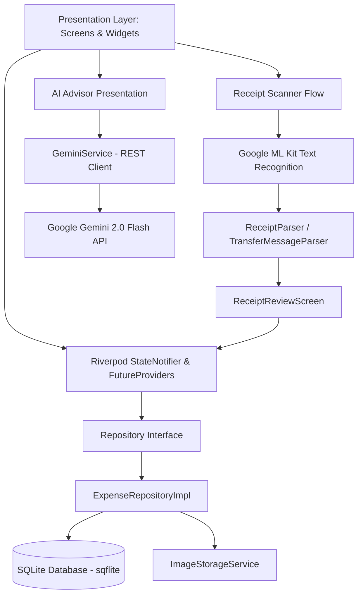

# Kiến trúc Ứng dụng VKU Expense AI

Tài liệu thiết kế kiến trúc kỹ thuật hệ thống ứng dụng di động **VKU Expense AI** (`vkuexpenseocr`).

---

## 1. Tổng quan Kiến trúc

VKU Expense AI tuân theo kiến trúc **Feature-First Layered Architecture**, kết hợp chặt chẽ với **Repository Pattern**, nguyên lý **SOLID**, và quản lý trạng thái **Riverpod 2**.



### Nguyên tắc cốt lõi:
1. **Offline-first**: Dữ liệu chi tiêu được lưu trữ 100% cục bộ trong SQLite. Không phụ thuộc vào kết nối mạng cho các thao tác CRUD và OCR.
2. **Quyền riêng tư (Privacy-by-Design)**: Ảnh hóa đơn và văn bản OCR chỉ xử lý on-device qua Google ML Kit. Gemini chỉ nhận báo cáo tài chính tổng hợp (tổng tiền, tỷ lệ danh mục), tuyệt đối không gửi ảnh hay thông tin cá nhân.
3. **Số nguyên cho tiền tệ (Integer Money)**: Số tiền VND luôn được biểu diễn bằng kiểu `int` (đơn vị Đồng), triệt tiêu hoàn toàn sai số dấu phẩy động của số thực `double`.
4. **Không âm thầm suy đoán (Explicit Confirmation)**: Kết quả OCR luôn qua màn hình `ReceiptReviewScreen` cho người dùng chỉnh sửa và xác nhận trước khi ghi vào database.

---

## 2. Cấu trúc Thư mục

```
lib/
├── core/                       # Thành phần dùng chung toàn ứng dụng
│   ├── constants/              # Hằng số cấu hình (tên DB, múi giờ, phiên bản)
│   ├── errors/                 # Phân cấp ngoại lệ AppException (sealed class)
│   ├── network/                # ConnectivityService kiểm tra mạng
│   ├── theme/                  # Material 3 light/dark theme
│   └── utils/                  # CurrencyFormatter, DateFormatter
├── data/                       # Tầng dữ liệu (Data Layer)
│   ├── database/               # AppDatabase (SQLite singleton, WAL, schema)
│   ├── repositories/           # ExpenseRepositoryImpl (CRUD, aggregations)
│   └── services/               # GeminiService, ImageStorageService
├── domain/                     # Tầng nghiệp vụ cốt lõi (Domain Layer)
│   ├── models/                 # Expense, ExpenseCategory, ReceiptOcrResult, SpendingSummary
│   └── repositories/           # ExpenseRepository (abstract interface)
├── features/                   # Tầng tính năng (Feature-First)
│   ├── dashboard/              # Màn hình tổng quan, thẻ thống kê, giao dịch gần nhất
│   ├── expenses/               # Danh sách giao dịch, lọc danh mục, thêm/sửa form
│   ├── receipt_scanner/        # Scanner camera/thư viện, ReceiptParser, Review screen
│   ├── statistics/             # Biểu đồ DonutChart và WeeklyBarChart (CustomPainter)
│   ├── ai_advisor/             # Phân tích chi tiêu với Google Gemini
│   └── settings/               # Cấu hình theme, ngân sách, API key, xóa dữ liệu
├── routing/                    # Điều hướng GoRouter với StatefulShellRoute
├── app.dart                    # Widget gốc VkuExpenseApp
└── main.dart                   # Điểm khởi chạy ứng dụng
```

---

## 3. Chi tiết các Tầng Kiến trúc

### 3.1. Domain Layer
- **Expense**: Entity đại diện cho một khoản chi tiêu. Các trường quan trọng: `amount: int`, `category: ExpenseCategory`, `transactionDate: DateTime`, `sourceType: String` (`manual`, `ocr`, `transfer`).
- **ExpenseCategory**: Enum 9 danh mục thiết yếu cho sinh viên: Ăn uống, Di chuyển, Mua sắm, Hóa đơn, Nhà ở, Sức khỏe, Giáo dục, Giải trí, Khác. Tích hợp hàm `suggestFromText(String)` dùng Regex từ khóa để phân loại tự động từ OCR.
- **ReceiptOcrResult**: Chứa kết quả trích xuất: merchant, amount, transactionDate, categorySuggestion, paymentMethod, confidence score (`high`, `medium`, `low`, `unknown`) và danh sách warnings.
- **ExpenseRepository**: Giao diện trừu tượng, tuân theo Dependency Inversion Principle. Presentation chỉ giao tiếp qua interface này.

### 3.2. Data Layer
- **AppDatabase**:
  - Quản lý SQLite qua `sqflite`.
  - Cấu hình **WAL Mode** (`PRAGMA journal_mode=WAL`) để hỗ trợ đọc/ghi đồng thời mà không bị lock database.
  - Tạo chỉ mục (`idx_expenses_date`, `idx_expenses_category`) tối ưu tốc độ truy vấn biểu đồ và lọc.
- **ExpenseRepositoryImpl**:
  - Thực thi toàn bộ thao tác CRUD.
  - Sử dụng trực tiếp SQL `SUM` và `GROUP BY` để tính toán tổng tiền, nhóm theo danh mục và nhóm theo 7 ngày trong tuần, giúp tiết kiệm bộ nhớ và đạt tốc độ tối đa thay vì tải toàn bộ bản ghi lên bộ nhớ Dart.

### 3.3. Presentation & State Management (Riverpod 2)
Sử dụng các provider phi mã nguồn (standard idiomatic Riverpod 2) không cần build_runner:
- `expenseRepositoryProvider`: Cung cấp instance của repository.
- `filteredExpensesProvider`: `FutureProvider` lắng nghe `expenseFilterNotifierProvider` để tự động query danh sách theo bộ lọc.
- `monthlySpendingSummaryProvider`, `weeklyDailyTotalsProvider`: Cung cấp dữ liệu thời gian thực cho Dashboard và Thống kê.
- `themeModeNotifierProvider`: Quản lý chế độ sáng/tối lưu trữ qua `SharedPreferences`.

---

## 4. Thuật toán Regex Receipt Parser

Lớp `ReceiptParser` phân tích OCR văn bản không phụ thuộc UI theo thứ tự ưu tiên:

1. **Trích xuất số tiền**:
   - **Mức ưu tiên 1 (High)**: Tìm nhãn rõ ràng: `TỔNG CỘNG`, `TỔNG THANH TOÁN`, `GRAND TOTAL`, `TOTAL AMOUNT`, `THÀNH TIỀN THANH TOÁN`.
   - **Mức ưu tiên 2 (Medium)**: Tìm nhãn phổ biến: `THÀNH TIỀN`, `TOTAL`, `AMOUNT`, `SỐ TIỀN`, `TIỀN THANH TOÁN`.
   - **Loại trừ**: Bỏ qua các dòng có nhãn `tiền thừa`, `tiền trả`, `change`, `discount`, `giảm giá`.
   - **Mức ưu tiên 3 (Fallback)**: Khi không có nhãn, tìm số tiền hợp lệ lớn nhất ở nửa dưới hóa đơn và gắn cảnh báo độ tin cậy vào kết quả.
2. **Trích xuất ngày tháng**:
   - Hỗ trợ định dạng: `dd/MM/yyyy`, `yyyy-MM-dd`, `dd-MM-yyyy`, `dd/MM/yy` (xử lý năm 2 chữ số 00-49 -> 2000+, 50-99 -> 1900+), và `ngày dd tháng MM năm yyyy`.
3. **Trích xuất người bán (Merchant)**:
   - Quét 8 dòng đầu tiên.
   - Bỏ qua số điện thoại, địa chỉ (cả có dấu và không dấu: `Dia chi`, `Tel`), mã giao dịch POS, tiêu đề hóa đơn (`Hoa don ban le`).
   - Tự động chuẩn hóa viết hoa Title Case.
4. **Đánh giá độ tin cậy (Confidence Scoring)**:
   - Điểm số cộng gộp dựa trên việc tìm thấy Số tiền (+3), Ngày (+2), Cửa hàng (+1) trừ đi số lượng cảnh báo (`warnings.length`).
   - Điểm $\ge 5 \rightarrow$ High, $\ge 3 \rightarrow$ Medium, $< 3 \rightarrow$ Low.

---

## 5. Tự vẽ Biểu đồ bằng CustomPainter

Theo đúng yêu cầu học phần, hệ thống không chỉ dùng thư viện mà bắt buộc tự vẽ 2 thành phần biểu đồ bằng `CustomPainter`:

### 5.1. DonutChart (`_DonutChartPainter`)
- Vẽ các cung tròn `canvas.drawArc` theo tỷ lệ phần trăm của từng danh mục.
- Hiệu ứng hoạt họa mượt mà qua `AnimationController` ($0.0 \rightarrow 1.0$).
- Phần tâm rỗng hiển thị thông tin tổng chi tiêu và nhãn tóm tắt.
- Chú thích (Legend) tương tác hiển thị màu sắc, tên danh mục, tỷ lệ % và số tiền.

### 5.2. WeeklyBarChart (`_BarChartPainter`)
- Vẽ 7 cột đại diện cho 7 ngày gần nhất.
- Tự động chuẩn hóa chiều cao cột theo giá trị lớn nhất trong tuần `maxValue`.
- Vẽ 4 đường lưới ngang ở các mốc 25%, 50%, 75%, 100% kèm nhãn giá trị compact (K, M).
- Hỗ trợ tương tác chạm `GestureDetector` kết hợp `LayoutBuilder` để phát hiện cột được chọn và hiển thị Tooltip nổi chứa ngày và số tiền chi tiết.
- Bo góc các cột bằng `RRect.fromRectAndRadius(Radius.circular(4))`.
