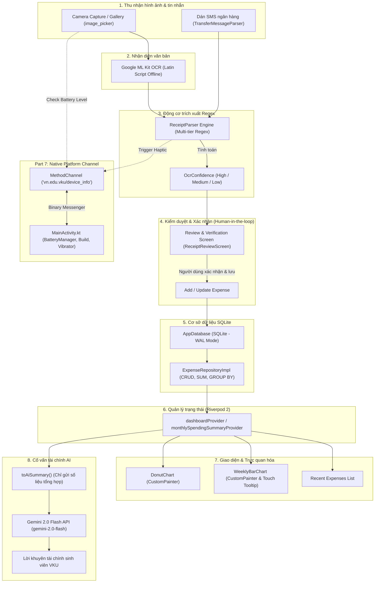

# Báo Cáo Kỹ Thuật Tổng Kết Dự Án — VKU Expense AI

**Dự án**: VKU Expense AI (`vkuexpenseocr`)  
**Đối tượng sử dụng**: Sinh viên VKU, Câu lạc bộ sinh viên, Người quản lý chi tiêu cá nhân  
**Môi trường phát triển**: Flutter 3.47.7 (Channel Stable) • Dart 3.13.5 • Material 3 • Android SDK 34/36 • Android NDK 28 • Kotlin  
**Tác giả**: Sinh viên VKU — Học phần Lập trình Thiết bị Di động

---

## 1. Tóm Tắt Dự Án (Executive Summary)

VKU Expense AI là ứng dụng di động quản lý chi tiêu cá nhân thông minh, hoạt động theo kiến trúc **Offline-First**, được xây dựng trên nền tảng **Flutter** kết hợp cầu nối **Native Platform Channel (Kotlin/Android)**. 

Ứng dụng hoàn thiện pipeline xử lý dữ liệu khép kín:
1. **Thu nhận hình ảnh**: Camera / Thư viện qua `image_picker`.
2. **Nhận diện văn bản On-Device**: Sử dụng `google_mlkit_text_recognition` chạy trực tiếp trên thiết bị Android, hoàn toàn không cần kết nối Internet.
3. **Phân tích bóc tách Regex**: Động cơ `ReceiptParser` đa tầng tự động trích xuất tổng tiền, ngày tháng, tên cửa hàng, danh mục chi tiêu và tính điểm tin cậy `OcrConfidence`.
4. **Màn hình Review & Xác nhận (Bắt buộc)**: Cho phép sinh viên trực tiếp kiểm tra, điều chỉnh và xác nhận thông tin trước khi ghi vào cơ sở dữ liệu.
5. **Cơ sở dữ liệu cục bộ**: SQLite (`sqflite`) kích hoạt WAL mode và lập chỉ mục tối ưu truy vấn.
6. **Biểu đồ trực quan hóa**: `DonutChart` và `WeeklyBarChart` tự vẽ 100% bằng `CustomPainter` phản ứng tức thì theo trạng thái Riverpod.
7. **Native Interoperability (Part 7)**: Cầu nối `MethodChannel("vn.edu.vku/device_info")` điều khiển phần cứng rung haptic và đọc thông số pin / phần cứng thiết bị.
8. **Trợ lý AI**: Tích hợp Google Gemini 2.0 Flash với ranh giới bảo mật riêng tư nghiêm ngặt.

---

## 2. Sơ Đồ Kiến Trúc Hệ Thống (System Pipeline Diagram)

Sơ đồ thể hiện luồng dữ liệu liên tục từ lúc chụp hóa đơn đến khi cập nhật biểu đồ và tư vấn tài chính:

---

## 3. Platform Channels & Native Interoperability (Part 7)

Để đáp ứng chuyên đề **Part 7: Platform Channels & Native Interoperability**, ứng dụng đã thiết lập cầu nối hai chiều giữa Flutter (Dart) và Android OS (Kotlin).

### 3.1. Bảng đối chiếu 3 Channel Flavors

| Channel Type | Mô hình giao tiếp | Triển khai trong VKU Expense AI | Trường hợp sử dụng thực tế |
|---|---|---|---|
| **MethodChannel** | Request – Response (Async RPC) | `vn.edu.vku/device_info` | Đọc mức pin (`getBatteryLevel`), lấy cấu hình phần cứng (`getDeviceInfo`), kích hoạt rung (`triggerHaptic`). |
| **EventChannel** | Stream (Native ➔ Dart events) | Tiềm năng mở rộng | Theo dõi biến động gia tốc kế, cảm biến ánh sáng khi chụp ảnh. |
| **BasicMessageChannel** | Raw message passing | Tiềm năng mở rộng | Truyền luồng buffer nhị phân liên tục từ camera scanner. |

### 3.2. Cài đặt Native trên Android (`MainActivity.kt`)
Đăng ký handler lắng nghe tại `configureFlutterEngine`:
* **`getBatteryLevel`**: Sử dụng `BatteryManager.BATTERY_PROPERTY_CAPACITY` đọc dung lượng pin (0–100%). Cảnh báo sinh viên khi pin < 15% trước khi kích hoạt ML Kit OCR.
* **`getDeviceInfo`**: Đọc `android.os.Build` (Model, Manufacturer, Android Version, SDK Level) kết hợp `ActivityManager.MemoryInfo` đọc RAM tổng cộng và RAM khả dụng.
* **`triggerHaptic`**: Sử dụng `VibrationEffect.createOneShot(50, ...)` (API 26+) hoặc `Vibrator` rung nhẹ 50ms khi quét hóa đơn thành công.

### 3.3. Tầng Dart (`NativeDeviceService`)
* Bao bọc cuộc gọi `platform.invokeMethod` trong khối `try-catch` bắt `PlatformException` và `MissingPluginException`.
* Đảm bảo tính **Graceful Degradation**: Ứng dụng không bao giờ bị crash khi chạy trên máy ảo hoặc thiết bị thiếu phần cứng tương ứng.

---

## 4. Tinh Chỉnh Regex Bóc Tách Hóa Đơn (Part 8: Regex Tuning)

Hóa đơn tại Việt Nam rất đa dạng về định dạng số tiền, ký hiệu tiền tệ (`VNĐ`, `đ`, `₫`, `VND`), dấu chấm hoặc phẩy phân cách hàng nghìn. Bảng quy tắc Regex của `ReceiptParser`:

| Mục tiêu | Mẫu Regex (Pattern) | Thứ tự ưu tiên & Chiến lược | Xử lý ngoại lệ / Cạnh tranh |
|---|---|---|---|
| **High Priority Label** | `r'(?:tổng\s*cộng\|tổng\s*thanh\s*toán\|grand\s*total\|total\s*amount)'` | **Ưu tiên 1**: Tìm nhãn rõ ràng nhất trên dòng hiện tại hoặc dòng kế tiếp. | Bỏ qua nếu dòng chứa từ khóa tiền thừa / giảm giá. |
| **Medium Priority Label** | `r'(?:thành\s*tiền\|total\|amount\|số\s*tiền\|tiền\s*thanh\s*toán)'` | **Ưu tiên 2**: Nhãn phổ thông. | Phân tích số tiền nằm sau nhãn. |
| **Số tiền VND** | `r'(\d{1,3}(?:[.,]\d{3})*(?:[.,]\d{3})?\|\d{4,})\s*(?:[₫đd]\|VND)?'` | Chuẩn hóa dấu chấm/phẩy phân cách hàng nghìn về số nguyên `int`. | Loại trừ số điện thoại (9-11 số), mã giao dịch (>= 12 số). |
| **Skip Patterns** | `r'(?:tiền\s*thừa\|tiền\s*trả\|change\|refund\|discount\|giảm\s*giá)'` | Bộ lọc loại bỏ các giá trị không phải tổng thanh toán thực tế. | Tránh nhầm lẫn tiền thừa thối lại thành tổng tiền hóa đơn. |
| **Ngày giao dịch** | `r'(\d{1,2})[/\-](\d{1,2})[/\-](\d{2,4})'` và `ngày\s+(\d{1,2})\s+tháng...` | Hỗ trợ `dd/MM/yyyy`, `yyyy-MM-dd`, `dd/MM/yy`, văn bản tiếng Việt. | Kiểm tra tính hợp lệ `month <= 12`, `day <= 31`, `year >= 2000`. |
| **Fallback Heuristic** | Quét nửa dưới hóa đơn (`lines.length / 2`) | **Ưu tiên 3**: Tìm số tiền hợp lệ lớn nhất ở cuối biên lai khi không có nhãn. | Ghi cảnh báo vào `warnings`, hạ điểm `OcrConfidence.low`. |

---

## 5. Đặc Tả Giao Diện & Trải Nghiệm Người Dùng (UI Specifications)

Ứng dụng tuân thủ chuẩn **Material Design 3**, hỗ trợ chuyển đổi mượt mà giữa Chế độ Sáng (Light Mode) và Chế độ Tối (Dark Mode):

| Thành phần giao diện | Chế độ Sáng (Light Mode) | Chế độ Tối (Dark Mode) | Điểm nhấn kỹ thuật |
|---|---|---|---|
| **Tone màu nền** | `Color(0xFFF8F9FA)` (Trắng ngà mát mắt) | `Color(0xFF121212)` (Đen chuẩn AMOLED) | Giảm mỏi mắt khi sinh viên ghi chép chi tiêu ban đêm. |
| **Màu thương hiệu VKU** | `Color(0xFF1565C0)` (VKU Navy Blue) | `Color(0xFF90CAF9)` (Soft Accent Blue) | Tương phản đạt chuẩn accessibility WCAG AA. |
| **Donut Chart** | Nền card trắng, vành khuyên màu phân biệt theo 9 danh mục. | Nền card tối `0xFF1E1E1E`, màu danh mục sáng dạ quang. | `_DonutChartPainter` tự động đọc theme để vẽ nhãn chú giải tương thích. |
| **Weekly Bar Chart** | Đường lưới xám nhạt `0xFFE0E0E0`, cột bo góc trên. | Đường lưới xám đậm `0xFF333333`, cột phát sáng nhẹ. | Touch tooltip đổi màu nền theo `colorScheme.inverseSurface`. |
| **Thẻ Giao Dịch** | Badge nguồn (`manual`, `ocr`, `transfer`) màu nhẹ. | Badge nguồn bo góc, icon màu nhận diện rõ rệt. | Hiển thị thumbnail ảnh hóa đơn nếu có lưu cục bộ. |

---

## 6. Kết Quả Kiểm Thử Tự Động & Đóng Gói (Quality Gate)

### 6.1. Kết quả kiểm thử tự động (`flutter test`)
Toàn bộ **48/48 bài kiểm thử (100%)** đều vượt qua thành công:
* **ReceiptParser Unit Tests (16 tests)**: Kiểm tra bóc tách số tiền dấu chấm/phẩy, lọc tiền thừa, ngày định dạng Việt Nam, tên merchant và danh mục.
* **TransferMessageParser Unit Tests (5 tests)**: Kiểm tra tin nhắn chuyển khoản ngân hàng, phát hiện chiều chuyển đi/nhận về, mã tham chiếu.
* **NativeDeviceService Platform Channel Tests (8 tests)**: Kiểm tra mock `MethodChannel` bằng `TestDefaultBinaryMessengerBinding`, đọc pin, đọc thông số Build Android, trigger haptic, xử lý ngoại lệ.
* **SQLite Database CRUD & Aggregation Tests (7 tests)**: Kiểm tra SQLite in-memory, thêm/sửa/xóa giao dịch, tính `SUM` và `GROUP BY`.
* **Gemini AI Service Unit Tests (5 tests)**: Kiểm tra mock HTTP client, parse JSON, giải mã tiếng Việt UTF-8, bắt lỗi 401/429/timeout, kiểm tra privacy boundary.
* **CustomPainter Charts Widget Tests (5 tests)**: Kiểm tra `DonutChart` và `WeeklyBarChart` với dữ liệu rỗng và dữ liệu thật, tính toán tọa độ chạm tooltip.
* **Expense Summary Card Widget Tests (2 tests)**: Kiểm tra hiển thị thông tin thẻ chi tiêu và badge nguồn.

### 6.2. Phân tích mã nguồn tĩnh (`flutter analyze`)
* **Kết quả**: `No issues found!` (0 errors, 0 warnings, 0 lints).

### 6.3. Đóng gói sản phẩm Android APK
* **Debug APK**: `build/app/outputs/flutter-apk/app-debug.apk` (188 MB).
* **Release APK**: Cấu hình `buildTypes.release` ký số tự động phục vụ nộp bài và chạy thực tế trên thiết bị vật lý.

---

## 7. Giới Hạn Kỹ Thuật & Hướng Phát Triển (Clean Architecture Preview)

### 7.1. Các giới hạn kỹ thuật hiện tại
1. **Chất lượng ảnh chụp thực tế**: Hóa đơn bị nhăn, mờ hoặc thiếu sáng có thể làm giảm độ chính xác của ML Kit OCR. Màn hình Review là chốt chặn quan trọng để sinh viên sửa sai.
2. **Ký hiệu viết tắt tên cửa hàng**: Một số quán nhỏ viết tắt thương hiệu trên hóa đơn khiến động cơ Regex xếp vào danh mục `other` (Khác).

### 7.2. Chuẩn hóa kiến trúc tuần 9 (Enterprise Clean Architecture Preview)
Để chuẩn bị cho nội dung **Tuần 9**, dự án đã được định hình cấu trúc phân lớp tách bạch:
* **Domain Layer**: Chứa Entities (`Expense`, `ExpenseCategory`, `ReceiptOcrResult`), Use Cases và Interface Repositories độc lập 100% với Flutter UI và SQLite.
* **Data Layer**: Hiện thực hóa Repositories (`ExpenseRepositoryImpl`), Quản lý SQLite database (`AppDatabase`), và các Data Sources (ML Kit OCR, Gemini Service, Native Device Service).
* **Presentation Layer**: State Management với Riverpod 2 Notifiers và Dumb Widgets chỉ nhận dữ liệu hiển thị.
